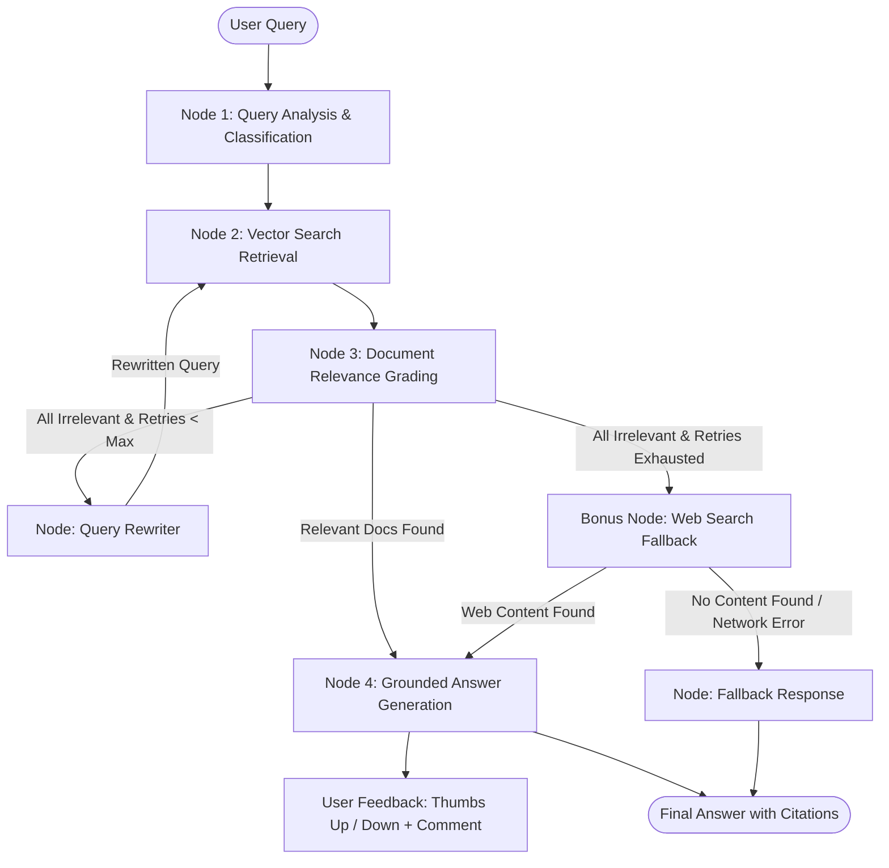

# Technical Documentation Assistant (Self-Corrective RAG)

A production-grade Retrieval-Augmented Generation (RAG) assistant designed for technical documentation. Built using **LangGraph**, **FastAPI**, **Google Gemini**, **HuggingFace Embeddings**, and **ChromaDB**, with an interactive **Streamlit** user interface.

The system incorporates **self-corrective retrieval** inspired by Corrective RAG (CRAG) and Self-RAG, including query analysis, LLM-based document grading, automatic query rewriting with retry limits, web search fallback, multi-format ingestion (`.md`, `.txt`, `.html`, URLs), and human feedback collection.

---

## Architecture Overview

The system models the question-answering lifecycle as a state machine using a LangGraph `StateGraph`.

### Workflow Diagram



### Graph Nodes & Self-Corrective Logic

1. **Node 1: Query Analysis (`query_analysis`)**:
   - Analyzes raw user questions, rewrites ambiguities, and classifies queries by type (`conceptual`, `how-to`, `troubleshooting`, `api_reference`).
2. **Node 2: Retrieval (`retrieve`)**:
   - Queries ChromaDB using dense semantic similarity with `sentence-transformers/all-MiniLM-L6-v2` embeddings, retrieving the top-$k$ document chunks with source metadata.
3. **Node 3: Document Grading (`grade_documents`)**:
   - Evaluates each retrieved chunk using an LLM-as-a-judge to filter out noise. Only chunks deemed relevant are retained for generation.
4. **Conditional Routing (`route_after_grading`)**:
   - **Generation Path**: If at least one relevant document is found, immediately proceeds to generation.
   - **Rewrite Path**: If no documents are relevant and retry budget remains (`retry_count < max_retries`), the query is rewritten with focused search keywords and re-retrieved.
   - **Web Search Fallback**: If retries are exhausted without finding relevant corpus chunks, execution transitions to web search.
5. **Bonus Node: Web Search Fallback (`web_search`)**:
   - Queries real-time search APIs (Tavily, Serper, or DuckDuckGo) for external documentation. If results are found, routes to generation with web citations; otherwise, transitions to graceful fallback.
6. **Node 4: Generation (`generate`)**:
   - Generates an accurate, grounded answer strictly constrained to the validated context, complete with source links and citations.
7. **Node 5: Fallback Response (`fallback`)**:
   - Returns a safe, deterministic message indicating insufficient information when context cannot be located.

---

## State Schema (`GraphState`)

The pipeline tracks data across graph nodes via a typed state dictionary:

| Field | Type | Description |
|---|---|---|
| `original_question` | `str` | Raw question submitted by the user |
| `query` | `str` | Current active query (rewritten or expanded) |
| `query_type` | `Optional[str]` | Classification (`how-to`, `conceptual`, etc.) |
| `retrieved_documents`| `List[Document]` | Raw chunks returned by similarity search |
| `relevant_documents` | `List[Document]` | Chunks validated by the grading node |
| `retry_count` | `int` | Number of rewrite/re-retrieval attempts made |
| `max_retries` | `int` | Maximum allowed query rewrite cycles (default: 2) |
| `answer` | `Optional[str]` | Generated response text |
| `sources` | `List[str]` | Unique source document paths or web URLs cited |
| `search_source` | `Optional[str]` | Origin of data: `"vector_store"` or `"web_search"` |

---

## Setup Instructions

### 1. Prerequisites

- Python 3.10+ (tested with Python 3.12 & 3.14)
- Git

### 2. Clone Repository & Setup Virtual Environment

```bash
git clone <repository-url>
cd Assignment

# Create virtual environment
python3 -m venv .venv

# Activate virtual environment
# On macOS / Linux:
source .venv/bin/activate
# On Windows:
# .venv\Scripts\activate
```

### 3. Install Dependencies

```bash
pip install --upgrade pip
pip install -r requirements.txt
```

### 4. Configure Environment Variables

Create a `.env` file in the project root:

```env
# Required: Google Gemini API Key
GEMINI_API_KEY=your_gemini_api_key_here

# Optional: Web Search Fallback Providers (Tavily or Serper)
# If neither is set, DuckDuckGo is used as zero-config fallback
TAVILY_API_KEY=your_tavily_api_key_here
SERPER_API_KEY=your_serper_api_key_here
```

---

## Ingesting Technical Documentation

The ingestion pipeline supports **Markdown (`.md`)**, **Plain Text (`.txt`)**, **HTML (`.html`, `.htm`)**, and **Live URLs**.

### Ingesting Seed Documents

Run the seed script to index local markdown and documentation files in `data/seed_documents/`:

```bash
python scripts/ingest_seed.py
```

### Ingesting Live Web Documentation

Run the URL scraper script to fetch, clean, chunk, and index live documentation (e.g., FastAPI tutorials):

```bash
python scripts/ingest_urls.py
```

---

## Running the Application

### 1. Start the FastAPI Backend

```bash
uvicorn app.main:app --reload --port 8000
```

- API Base URL: `http://127.0.0.1:8000`
- Interactive Swagger Docs: `http://127.0.0.1:8000/docs`
- ReDoc Docs: `http://127.0.0.1:8000/redoc`

### 2. Start the Streamlit Frontend

In a separate terminal (with `.venv` activated):

```bash
streamlit run frontend/app.py
```

- Web UI opens at: `http://localhost:8501`
- Includes live backend health status, knowledge upload manager, chat interface, expandable response reasoning details, and interactive **thumbs up / thumbs down** feedback with comments.

### 3. Running Unit & Integration Tests

```bash
pytest
```

---

## API Reference & Examples

### 1. `POST /chat` (or `POST /query`)
Submit a natural language question.

**Request:**
```bash
curl -X POST http://127.0.0.1:8000/chat \
  -H "Content-Type: application/json" \
  -d '{"question": "How do I raise a 404 HTTP exception in FastAPI?"}'
```

**Response (HTTP 200):**
```json
{
  "answer": "To raise a 404 HTTP exception in FastAPI, import `HTTPException` from `fastapi` and raise it with `status_code=404` and a `detail` message.",
  "sources": [
    "data/seed_documents/fastapi_error_handling.md"
  ],
  "query_type": "how-to",
  "retries_used": 0,
  "search_source": "vector_store"
}
```

---

### 2. `POST /ingest/file`
Upload and index a Markdown, text, or HTML document.

**Request:**
```bash
curl -X POST http://127.0.0.1:8000/ingest/file \
  -F "file=@data/seed_documents/fastapi_basics.md"
```

**Response (HTTP 200):**
```json
{
  "message": "File 'fastapi_basics.md' ingested successfully",
  "documents_processed": 1,
  "chunks_created": 3
}
```

---

### 3. `POST /ingest/url`
Ingest and index a web documentation page.

**Request:**
```bash
curl -X POST http://127.0.0.1:8000/ingest/url \
  -H "Content-Type: application/json" \
  -d '{"url": "https://fastapi.tiangolo.com/tutorial/path-params/"}'
```

**Response (HTTP 200):**
```json
{
  "message": "URL ingested successfully",
  "documents_processed": 1,
  "chunks_created": 5
}
```

---

### 4. `GET /documents`
List indexed documents and total chunk count in the corpus.

**Request:**
```bash
curl -X GET http://127.0.0.1:8000/documents
```

**Response (HTTP 200):**
```json
{
  "total_chunks": 18,
  "documents": [
    "data/seed_documents/fastapi_basics.md",
    "data/seed_documents/fastapi_error_handling.md",
    "https://fastapi.tiangolo.com/tutorial/path-params/"
  ]
}
```

---

### 5. `POST /feedback`
Submit user rating (thumbs up / thumbs down) with optional qualitative comments.

**Request:**
```bash
curl -X POST http://127.0.0.1:8000/feedback \
  -H "Content-Type: application/json" \
  -d '{
    "rating": "thumbs_up",
    "comment": "Accurate answer and cited the exact file.",
    "question": "How do I raise a 404 HTTP exception in FastAPI?",
    "answer": "To raise a 404 HTTP exception in FastAPI..."
  }'
```

**Response (HTTP 200):**
```json
{
  "message": "Feedback submitted successfully",
  "status": "success"
}
```

---

### 6. `GET /feedback`
Retrieve feedback records for quality evaluation.

**Request:**
```bash
curl -X GET http://127.0.0.1:8000/feedback
```

---

## Technical Write-Up: Architectural Reasoning, Tradeoffs & Strategy

### 1. Thought Process & Reasoning Behind the Architecture

Standard "naive" RAG architectures suffer from a critical flaw: they assume that semantic vector similarity directly correlates with factual answerability. In technical documentation, this assumption frequently breaks down:
- A user asks how to accomplish a specific task, but vector similarity retrieves chunks containing similar terminology without the actual operational instructions.
- The user's query is colloquially phrased, poorly worded, or ambiguous, leading vector search astray into irrelevant sections of the documentation.
- When irrelevant documents are fed into the generation prompt, the LLM either hallucinates an answer or admits defeat even though the answer exists elsewhere under different keywords.

To solve this, our system employs a **self-corrective, graph-based architecture** implemented with **LangGraph**:

1. **Explicit Query Analysis**:
   Before querying the vector index, the system analyzes the user's intent and extracts query metadata (`query_type`). Classifying whether a question is `conceptual`, `how-to`, `troubleshooting`, or `api_reference` prepares the system for specialized handling and contextual clarity.

2. **Self-Correction through Document Grading (LLM-as-a-Judge)**:
   Instead of blindly trusting the top-$k$ nearest neighbors from the vector store, each retrieved chunk is evaluated individually for binary relevance (`{"relevant": true|false}`). This prevents noisy, irrelevant chunks from entering the generation context, which directly mitigates contextual hallucination.

3. **Controlled Query Rewriting with Strict Retry Budgeting**:
   If document grading discovers that *none* of the retrieved documents are relevant, the pipeline does not immediately fail. Instead, it enters an automated self-correction loop where the query is rewritten to clarify intent, remove colloquial noise, and introduce technical synonyms. Crucially, the loop is bound by a strict counter (`retry_count` vs. `max_retries = 2`) to guarantee termination and avoid cyclic latency explosions.

4. **Multi-Tier Fallback Strategy (Web Search $\rightarrow$ Safe Deterministic Fallback)**:
   If internal retrieval fails even after retrying, the pipeline falls back to live web search (via Tavily, Serper, or DuckDuckGo). This allows the assistant to answer questions about newly released APIs, related third-party libraries, or topics missing from the local corpus, while always maintaining source citations. If web search also produces no relevant results, the system outputs a deterministic, polite "insufficient information" response rather than hallucinating.

---

### 2. Chunking & Embedding Strategy Choices

Technical documentation presents distinct chunking challenges compared to generic narrative prose. Code samples, function declarations, parameters, and explanatory text must remain coherent rather than being bisected mid-syntax.

#### Chunking Strategy: `RecursiveCharacterTextSplitter`
- **Chunk Size: 1000 characters**:
  - *Reasoning*: A 1000-character window comfortably accommodates 15–25 lines of code alongside accompanying narrative explanations or parameter definitions. Chunks smaller than 500 characters frequently sever functions from their imports and usage examples; chunks larger than 1500 characters dilute dense vector representations and introduce irrelevant context.
- **Chunk Overlap: 200 characters (20%)**:
  - *Reasoning*: Overlap ensures that syntactic context (such as function signatures, variable names, and transitional commentary) is preserved across contiguous boundaries, preventing edge effects during semantic matching.
- **Separators Hierarchy (`["\n\n", "\n", ". ", " ", ""]`)**:
  - *Reasoning*: Splitting strictly prioritizes paragraph breaks (`\n\n`), followed by single line breaks (`\n`), sentence terminators (`. `), and words. This ensures code blocks and Markdown bullet lists remain intact whenever possible.
- **Pre-Chunking HTML Sanitization**:
  - *Reasoning*: Raw HTML contains boilerplate markup (`<script>`, `<style>`, `<nav>`, `<footer>`) that degrades embedding quality. Ingested HTML files and scraped web pages are pre-processed using BeautifulSoup to decompose structural boilerplate and extract clean, readable text before splitting.

#### Embedding Model Choice: `sentence-transformers/all-MiniLM-L6-v2`
- **Locally Hosted vs. Cloud Embeddings (e.g., OpenAI `text-embedding-3-small`)**:
  - *Reasoning*: We chose `all-MiniLM-L6-v2` (384 dimensions) for several concrete engineering reasons:
    1. **Zero Cost & Rate Limits**: Running embeddings locally eliminates external API costs, quota exhaustion, and rate limit errors during bulk document ingestion.
    2. **Low Latency & High Efficiency**: The 384-dimensional dense vectors provide an optimal tradeoff between retrieval speed, memory footprint in ChromaDB, and semantic accuracy on technical English text.
    3. **100% Reproducibility & Privacy**: The model operates entirely offline without sending proprietary internal documentation to third-party endpoints.

---

### 3. Key Assumptions Made

1. **Document Format & Encoding**:
   - Assumed technical documentation is provided in standard UTF-8 encoded text, Markdown (`.md`), HTML (`.html`, `.htm`), or accessible via standard HTTP/HTTPS URLs.
2. **Deterministic Fallback over Unverified Inference**:
   - Assumed that returning a confident, honest "insufficient information" message is vastly preferable to an ungrounded or fabricated answer.
3. **Stateless Single-Turn RAG per Invocation**:
   - Assumed graph invocations are self-contained per question/response cycle. Session history is maintained by the Streamlit frontend client, while each backend graph execution focuses on solving the immediate user query with high precision.
4. **Environment Portability**:
   - Assumed the application may be deployed in environments with or without paid third-party search subscriptions. As such, the web search fallback is designed to support Tavily and Serper when keys are available, and gracefully falls back to DuckDuckGo when keys are omitted.

---

### 4. Design Decisions & Tradeoffs Summary

| Architectural Decision | Chosen Approach | Alternative Considered | Tradeoff / Justification |
|---|---|---|---|
| **Pipeline Control** | LangGraph `StateGraph` | Linear LangChain Chain | Slightly higher graph initialization complexity; enables cyclic retries and conditional routing impossible in linear chains. |
| **Document Relevance** | LLM-as-a-judge (structured JSON) | Cosine similarity threshold | LLM grading adds latency (~400ms) but eliminates vector score calibration errors across different document distributions. |
| **Vector Database** | ChromaDB (local persistence) | FAISS / Pinecone | ChromaDB provides embedded persistence, SQLite metadata filtering, and zero infrastructure setup, avoiding cloud database dependencies. |
| **Web Search Fallback** | Multi-tier (Tavily / Serper / DuckDuckGo) | Local-only or single provider | Ensures robustness across differing developer environments without requiring mandatory API billing setup. |
| **User Feedback** | Integrated `POST /feedback` + Streamlit UI | External analytics tooling | Direct in-app ratings (👍/👎 + comments) stored locally in `data/feedback.json` create a tangible dataset for offline evaluation. |

---

### 5. What Would Be Improved With More Time

1. **Cross-Encoder Reranking**:
   - Introduce a high-precision reranker (e.g., `cross-encoder/ms-marco-MiniLM-L-6-v2` or Cohere Rerank) between vector retrieval and document grading. This would allow retrieving top-20 chunks cheaply, reranking them, and sending only top-5 to the LLM grader, optimizing both speed and token cost.
2. **Conversational Memory with Checkpointing**:
   - Integrate LangGraph's native checkpointer (`MemorySaver` or PostgreSQL checkpointing) to support multi-turn conversational follow-ups (e.g., *"How do I test the endpoint you just described?"*).
3. **Automated RAG Triad Evaluation**:
   - Implement an automated testing pipeline using **Ragas** or **TruLens** to quantitatively track Context Precision, Context Recall, Faithfulness, and Answer Relevance against the logged feedback dataset.
4. **Streaming Token Generation**:
   - Implement Server-Sent Events (SSE) or WebSocket streaming from FastAPI to Streamlit to minimize Time-To-First-Token (TTFT) and improve perceived UI responsiveness.
5. **Hybrid Search (Dense + Sparse)**:
   - Combine dense vector embeddings with sparse keyword search (BM25) using Reciprocal Rank Fusion (RRF). Technical documentation frequently relies on exact method identifiers (e.g., `HTTPException`, `status_code=404`) where lexical matching outperforms purely semantic representations.
